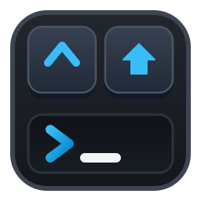
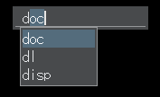
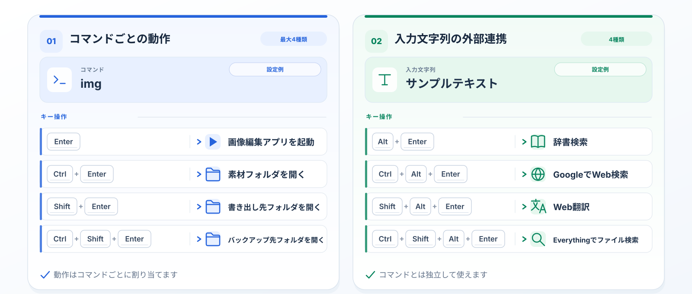

[英語](README.md) | [日本語](README.ja.md)

# ReCraftLaunch

Windows向けのコンパクトなキーボードランチャー

## プロジェクト概要

ReCraftLaunchは、craftwareによる **CraftLaunch 3.40** を基にした派生プロジェクトです。  
p65536が独立して開発しており、craftwareはReCraftLaunchの開発には関与していません。

移植元からの変更点は[CraftLaunchとの機能差異](docs/ja/differences.txt)を参照してください。

## 主な機能

**少ないコマンドで、より多くの操作を。**

1つのコマンドに最大4種類の動作を割り当てられます。  
さらに、入力文字列に対して独立した4種類の外部連携操作を設定できます。

- **コマンドごとに4種類の動作を登録可能**：1つのコマンドに最大4種類の動作を登録し、EnterとCtrl・Shiftの組み合わせで使い分けられます。修飾キーごとの動作が未登録の場合は、共通設定の「修飾キーの既定動作」が適用されます。

    - **設定例：画像編集アプリ**

        | キー | 動作 |
        |---|---|
        | Enter | 画像編集アプリを起動 |
        | Ctrl+Enter | 素材フォルダを開く |
        | Shift+Enter | 書き出し先フォルダを開く |
        | Ctrl+Shift+Enter | バックアップ先フォルダを開く |

- **入力文字列の外部連携を4種類設定可能**：登録コマンドとは独立した機能です。メイン入力欄の任意の文字列を外部アプリやWeb検索へ渡せます。Alt+EnterとCtrl・Shiftの組み合わせで4種類の動作を使い分けられます。

    - **設定例：Alt+Enter系操作**
    
        | キー | 動作 |
        |---|---|
        | Alt+Enter | 辞書検索（EBWin4、GoldenDict-ngなど） |
        | Ctrl+Alt+Enter | GoogleでWeb検索 |
        | Shift+Alt+Enter | Web翻訳 |
        | Ctrl+Shift+Alt+Enter | Everythingでファイル検索 |

- **キーボードによる起動と補完**：コマンド名・実行ファイル・パス・URLを入力して起動できます。
- **表示と入力の設定**：配色テーマ・フォント・ホットキー・履歴・補完動作を変更できます。
- **Pythonによる拡張**：自作のPythonスクリプトで独自コマンドや処理を追加し、ランチャーの動作を拡張できます。

## 動作環境

- **OS・アーキテクチャ**：Windows x64
- **Python**：Python 3.15を同梱。別途インストールは不要です。
- **VCランタイム**：Microsoft Visual C++ v14 Redistributable（x64）。必要に応じて最新版を導入してください。ランタイムDLLは同梱しません。

## インストール

1. [Releases](https://github.com/p65536/ReCraftLaunch/releases)から最新の`ReCraftLaunch_<version>.zip`をダウンロードしてください。
2. 任意のフォルダにZIPを展開し、**`reclnch.exe`** を起動してください。

設定は既定でインストール先フォルダの`settings/`に保存します。configの「設定の保存先」で`%APPDATA%\ReCraftLaunch`を選ぶこともできますが、反映はアプリ再起動後で、既存設定の自動コピー・移動は行いません。

### 言語設定

日本語・英語のUIとヘルプを同梱しています。  
初期言語は英語です。日本語に変更する手順は以下。

1. 設定メニューを開く（メイン入力欄に`config`と入力してEnter、またはメイン入力欄で`Ctrl+S`押下）
2. 「Language」を開き「Japanese」を選択してEnter
3. ReCraftLaunchを再起動
   1. ReCraftLaunchを終了：メイン入力欄に`quit`と入力してEnter
   2. ReCraftLaunchを起動：`reclnch.exe`を実行

## バージョンアップ

1. [Releases](https://github.com/p65536/ReCraftLaunch/releases)から最新の`ReCraftLaunch_<version>.zip`をダウンロードしてください。
2. ZIP展開後のファイルをインストール先に上書きしてください。個人設定は上書きされません。

## アンインストール

1. ReCraftLaunchを終了し、展開したフォルダを削除します。フォルダ内に保存した設定も削除されます。
2. 設定保存先にAppDataフォルダを利用している場合は`%APPDATA%\ReCraftLaunch`を削除します。
3. 自分で作成したショートカットやスタートアップ登録があれば削除します。

ReCraftLaunchはWindowsレジストリを変更しないため、レジストリの操作は不要です。

## ヘルプ

使い方や設定は、アプリ内で **F1** を押すか、展開先の`docs/ja/index.html`または`docs/en/index.html`を開いて確認してください。

マニュアル：[日本語](docs/ja/index.txt)・[英語](docs/en/index.txt)。

## 開発者向け情報

READMEと利用者マニュアルは日本語・英語に対応しています。開発・設計・検証・文書生成のガイドは日本語のみです。

ソースからのビルドと[表示言語の選択](developer/development.md#表示言語の選択)は[開発・ビルドガイド](developer/development.md)、検証は[配布版の確認手順](developer/release-verification.md)を参照してください。

## ライセンスとクレジット

ReCraftLaunchのライセンスは[MIT License](LICENSE.md)です。

- 元のCraftLaunch：**craftware**、Copyright (c) 2023。[移植元のソース](https://github.com/crftwr/clnch)・[craftwareのサイト](https://sites.google.com/site/craftware/)
- ReCraftLaunch：**p65536**、Copyright (c) 2026。
- 構成要素には[ckit](ckit/LICENSE.md)・[pyauto](pyauto/LICENSE.md)を含みます。外部ライブラリのライセンス表記は[licenses/](licenses/)を参照してください。

## 作者

- [p65536](https://github.com/p65536)
