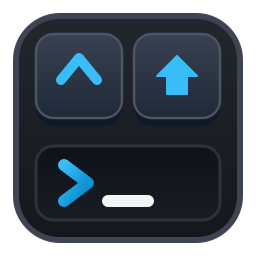
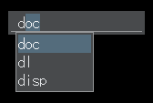
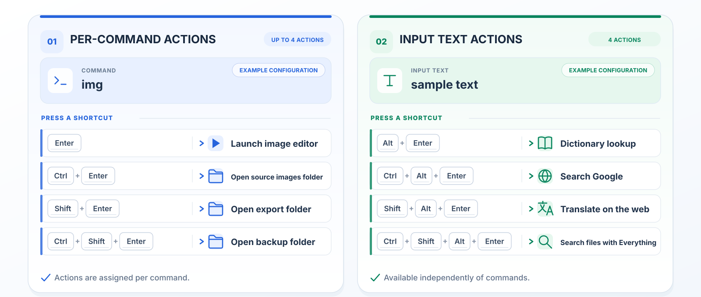

[English](README.md) | [Japanese](README.ja.md)

# ReCraftLaunch

A compact keyboard launcher for Windows.

## About This Project

ReCraftLaunch is a derivative of **CraftLaunch 3.40** by craftware.  
ReCraftLaunch is developed independently by p65536. craftware is not involved in the development of ReCraftLaunch.

See [Differences from CraftLaunch](docs/en/differences.txt) for changes from the original project.

## Features

**More actions. Fewer commands.**

Up to four actions per command, plus four independent actions for any input text.

- **Up to four actions per command**: Assign up to four different actions to a single command and select one using Enter with Ctrl and Shift modifiers. If no action is assigned for a modifier combination, the shared, configurable modifier default action applies.

    - **Example: Image editor**

        | Key | Action |
        |---|---|
        | Enter | Launch the image editor |
        | Ctrl+Enter | Open the source images folder |
        | Shift+Enter | Open the export folder |
        | Ctrl+Shift+Enter | Open the backup folder |

- **Four configurable actions for input text**: Independently of registered commands, send arbitrary text from the main input field to external applications or web searches. Choose between four actions using Alt+Enter with Ctrl and Shift modifiers.

    - **Example: Alt+Enter actions**

        | Key | Action |
        |---|---|
        | Alt+Enter | Look up words in a dictionary (e.g., EBWin4 or GoldenDict-ng) |
        | Ctrl+Alt+Enter | Search Google |
        | Shift+Alt+Enter | Translate text on the web |
        | Ctrl+Shift+Alt+Enter | Search for files with Everything |

- **Keyboard launching and completion**: Launch commands, executables, files, folders, and URLs by typing their names or paths.
- **Appearance and input settings**: Customize color themes, fonts, hotkeys, history, and completion behavior.
- **Python extensions**: Extend the launcher's functionality with custom commands and behavior using your own Python scripts.

## System Requirements

- **OS / architecture**: Windows x64
- **Python**: Python 3.15 is bundled; no separate installation is needed.
- **VC runtime**: Microsoft Visual C++ v14 Redistributable (x64). Install the latest version if needed; runtime DLLs are not included.

## Installation

1. Download the latest `ReCraftLaunch_<version>.zip` from [Releases](https://github.com/p65536/ReCraftLaunch/releases).
2. Extract the ZIP to any folder and run **`reclnch.exe`**.

Settings are stored in the `settings/` folder in the installation folder by default. You can select `%APPDATA%\ReCraftLaunch` in config > Settings location; the change takes effect after restarting the application and does not copy or move existing settings.

### Language Settings

Japanese and English UI and help are included.  
The default language is English. To switch to Japanese:

1. Open the configuration menu (type `config` in the main input field and press Enter, or press `Ctrl+S` in the main input field).
2. Open **Language**, select **Japanese**, and press Enter.
3. Restart ReCraftLaunch.
   1. Exit ReCraftLaunch: type `quit` in the main input field and press Enter.
   2. Start ReCraftLaunch: run `reclnch.exe`.

## Updating

1. Download the latest `ReCraftLaunch_<version>.zip` from [Releases](https://github.com/p65536/ReCraftLaunch/releases).
2. Overwrite the installation folder with the extracted files. Your personal settings are not overwritten.

## Uninstallation

1. Exit ReCraftLaunch and delete the extracted folder. This also deletes settings stored inside that folder.
2. If you store settings in the AppData folder, delete `%APPDATA%\ReCraftLaunch`.
3. Remove any shortcuts or startup entries you created.

ReCraftLaunch does not modify the Windows registry, so no registry cleanup is required.

## Help

For usage and settings, press **F1** in the application or open `docs/en/index.html` or `docs/ja/index.html` in the extracted folder.

Manual: [English](docs/en/index.txt) · [Japanese](docs/ja/index.txt).

## Developer Information

The README and user manuals are available in English and Japanese. The development, architecture, verification, and documentation build guides are available only in Japanese.

See the [development and build guide (Japanese)](developer/development.md), including [display language selection (Japanese)](developer/development.md#表示言語の選択), and the [verification procedures (Japanese)](developer/release-verification.md).

## License and Credits

ReCraftLaunch is licensed under the [MIT License](LICENSE.md).

- Original CraftLaunch: **craftware**, Copyright (c) 2023. [Original source](https://github.com/crftwr/clnch) · [craftware website](https://sites.google.com/site/craftware/)
- ReCraftLaunch: **p65536**, Copyright (c) 2026.
- Components include [ckit](ckit/LICENSE.md) and [pyauto](pyauto/LICENSE.md). See [licenses/](licenses/) for third-party license notices.

## Author

- [p65536](https://github.com/p65536)
